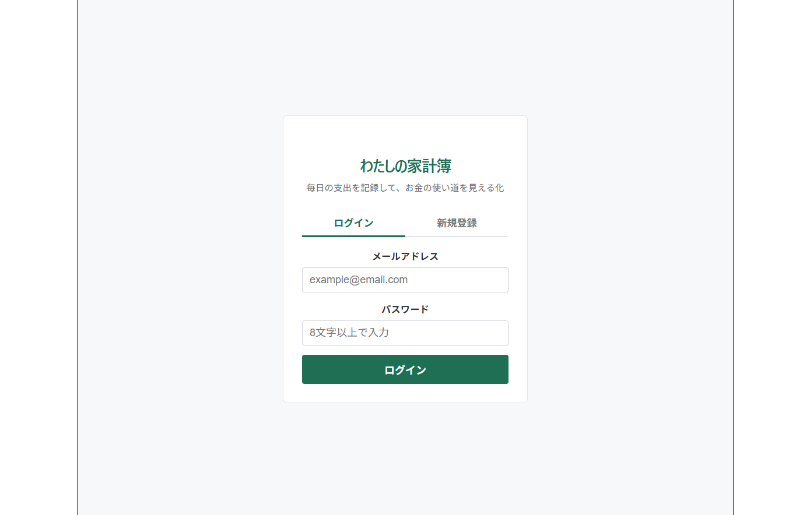
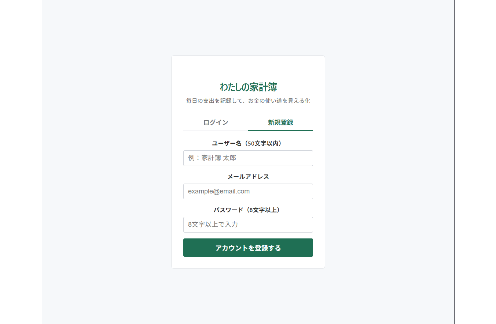
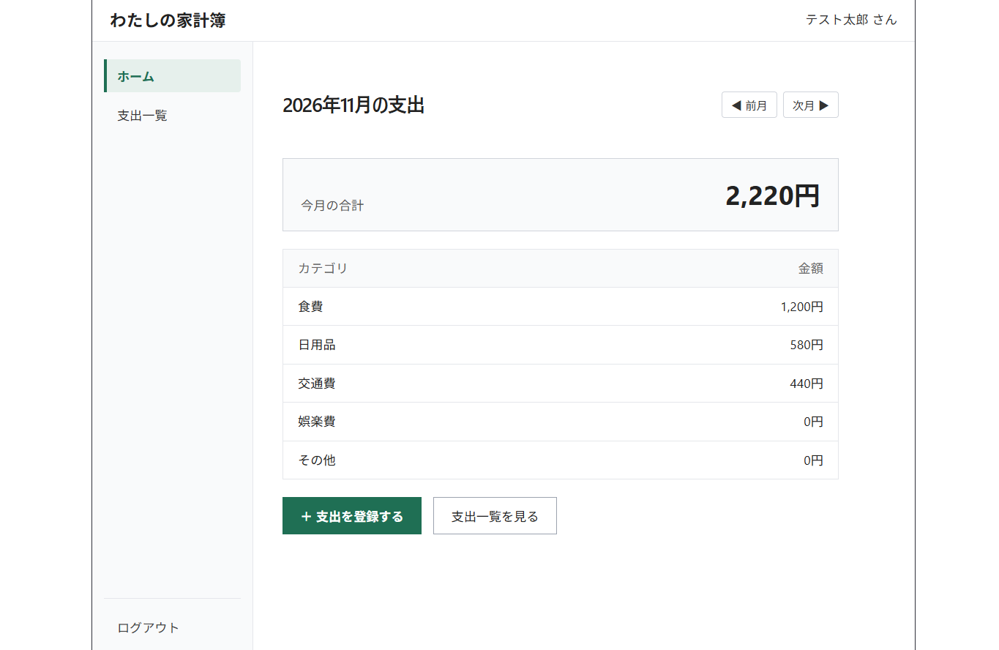
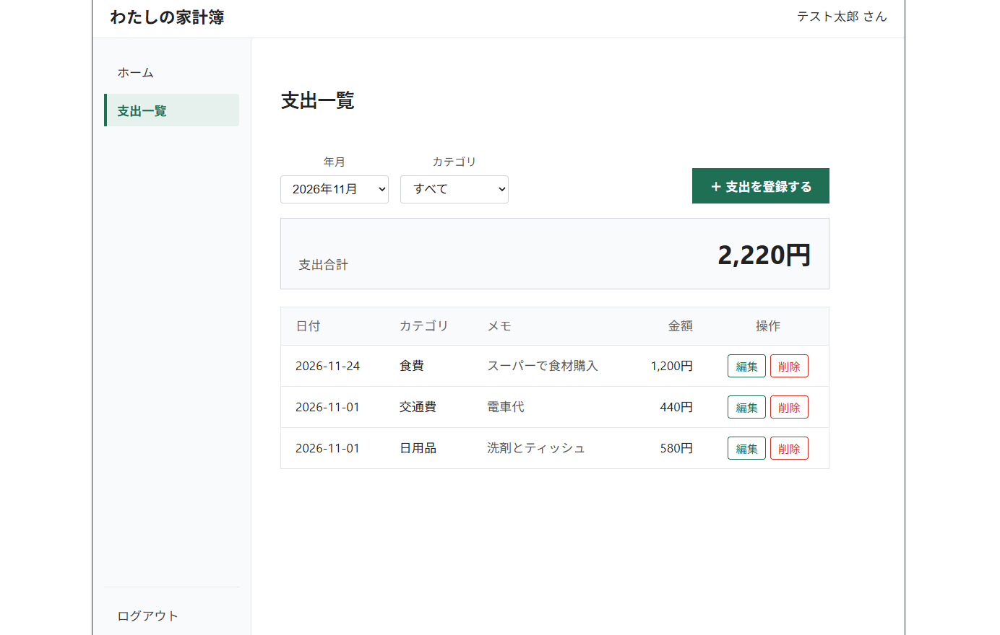
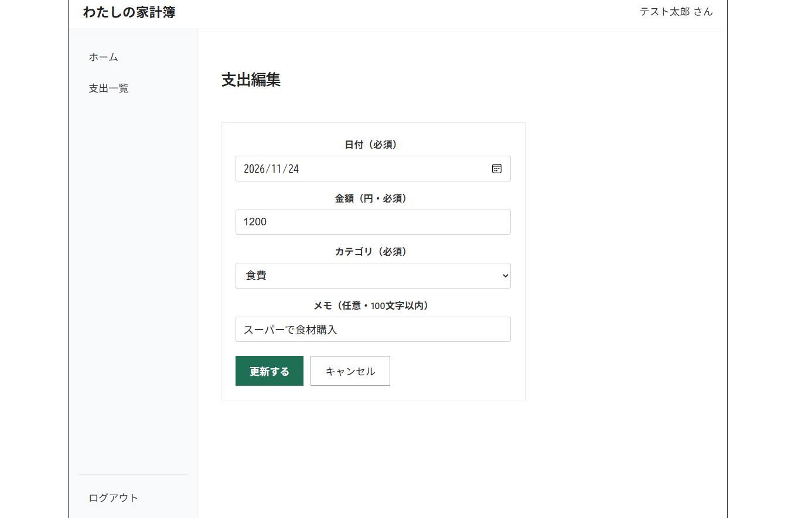
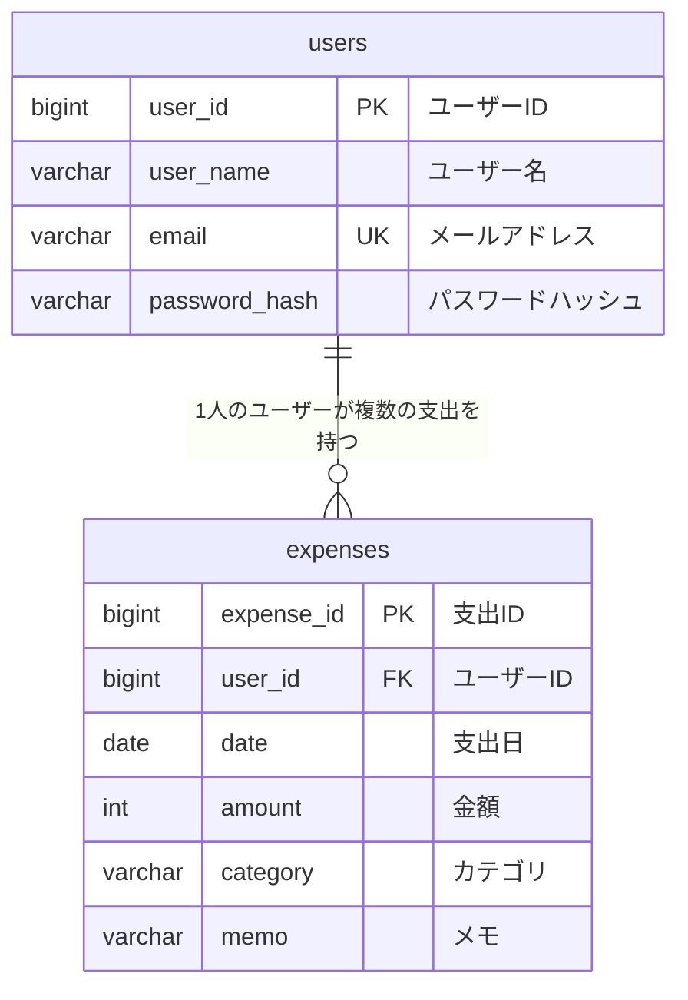

# わたしの家計簿

毎日の支出を記録して、月ごと・カテゴリごとにどれくらいお金を使ったか確認できる家計簿アプリです。

## 開発した背景や理由

普段どのカテゴリにどれくらいお金を使っているか把握できておらず、月末になって「思ったよりお金が減っている」と感じることがよくありました。既存の家計簿アプリは多機能すぎて使いこなすのが難しかったため、毎日の支出を最小限の入力（日付・金額・カテゴリ・メモ）ですぐに記録でき、月ごとの合計をひと目でわかるシンプルな家計簿アプリを作りました。

## アプリケーションのデモ（全画面一覧）

### ログイン画面

登録済みのメールアドレスとパスワードでログインできます。


### 新規登録画面

ユーザー名・メールアドレス・パスワード（8文字以上）を入力して新しくアカウントを作成できます。


### ホーム画面（月別集計）

対象月の支出合計金額と、カテゴリ別（食費・日用品・交通費・娯楽費・その他）の合計金額を確認できます。前月・次月ボタンで月の切り替えができます。


### 支出一覧画面

登録した支出の一覧表示に加えて、年月やカテゴリでの絞り込み、編集画面への移動、データの削除ができます。


### 支出登録画面

日付・金額・カテゴリ・メモを入力して新しい支出を登録できます。


### 支出編集画面

一覧画面の「編集」ボタンから、すでに登録した支出の日付や金額・メモなどを修正できます。


## 作った機能

- ユーザー登録、ログイン、ログアウト
- ホーム画面での月ごとの合計金額と、カテゴリ別の金額表示（前月・次月の切り替え）
- 支出一覧の表示（年月やカテゴリでの絞り込み、削除機能）
- 支出の登録と編集

## 使ったもの

- フロントエンド：React / Vite
- バックエンド：Java / Spring Boot
- データベース：H2 Database
- ツール：IntelliJ IDEA / VS Code / Thunder Client / GitHub

## ER図（データベース設計）



## 動かし方

### バックエンドの起動

```bash
cd backend
.\mvnw.cmd spring-boot:run
```

### フロントエンドの起動

別のターミナルで以下を実行して、表示されたURL（http://localhost:5173 など）をブラウザで開きます。

```bash
cd frontend
npm install
npm run dev
```

### ログイン確認用アカウント

起動するとテスト用のデータ（サンプル支出3件）が自動で入ります。

- メールアドレス：test@example.com
- パスワード：password123

## 工夫した点

- 設計書の画面イメージを見ながら、見やすいデザインになるように細かい部分を直しました。最初はパソコンの設定のせいか年月の枠の背景が黒っぽく見づらかったので白く直したり、左メニューのログアウトボタンの位置や、表の「カテゴリ」と下の項目の左端が揃うように調整しました。
- ログインしている自分のデータだけが見れるように、他のユーザーのデータは取得や削除ができないようにしました。
- 一気に全部作るとどこが間違っているか分からなくなるので、1つの機能ができるたびに画面やThunder Clientで動きを確かめてからコミットするようにしました。

## 苦労した点

- 最初はパソコンの中だけで環境構築や動作確認を進めていて、GitHubを作るのをすっかり忘れていました。途中で気づいて作り直しGitHubとつなぎ、そこからはこまめにコミットして履歴が残るように気をつけました。
- 最初にターミナルで動かしたバックエンドを止めないままIntelliJ IDEAからも起動しようとして、「8080番ポートがすでに使われている」というエラーが出て困りました。動いている方を止めてから起動することで直せました。
- Javaのファイル名のスペルを1文字間違えてエラーになったり、コマンドを打つフォルダの場所（System32など）を間違えてエラーになったりして、最初の環境構築に時間がかかりました。
- Spring Bootを動かしたままGitに上げようとしたとき、データベースのファイルが使用中でエラーになりました。データベースの保存フォルダをGitの対象から外す設定を入れて解決しました。
- バックエンドのIntelliJ IDEAは自動保存なので慣れてしまっていましたが、フロントエンドのVS Codeでは新しい画面のファイルを保存し忘れてしまい、ブラウザの画面が真っ白になって焦りました。タブの未保存マークに気づいて保存したらすぐ表示されてホッとしました。
